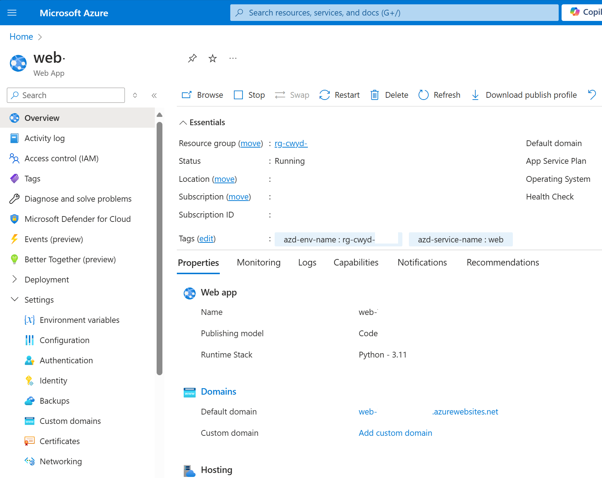
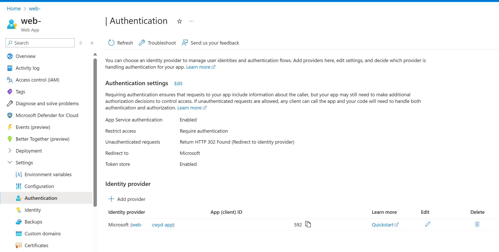
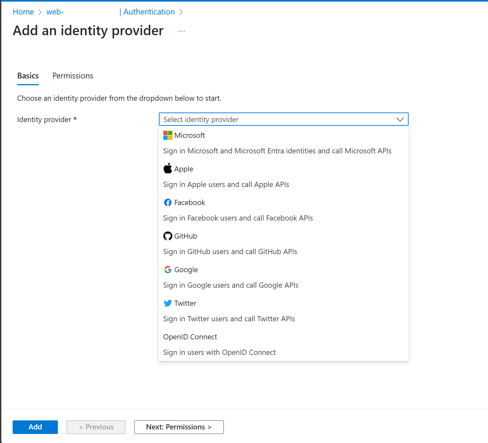
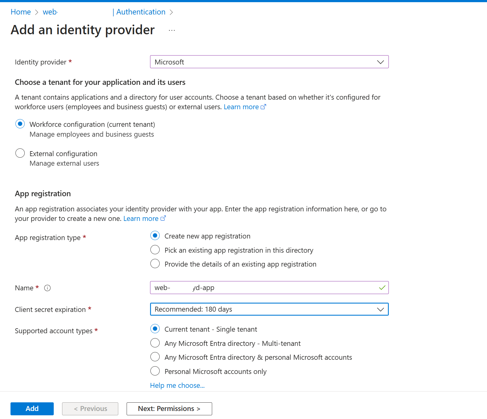

# Set Up Authentication in Azure App Service

This document provides step-by-step instructions to configure Azure App Registrations for a front-end application.

## Prerequisites

- Access to **Microsoft Entra ID**
- Necessary permissions to create and manage **App Registrations**

## Automated setup

Instead of Steps 1 and 2 below, you can run the following script from the project root, after the post-deployment script has finished. It creates (or reuses) the app registration, configures App Service authentication on the frontend, and sets `AUTH_CLIENT_ID` on the backend Container App.

- **For Bash (Linux/macOS/WSL):**

    ```bash
    bash infra/scripts/post-provision/configure_auth.sh
    ```

- **For PowerShell (Windows):**

    ```powershell
    .\infra\scripts\post-provision\configure_auth.ps1
    ```

The script reads the resource names from the current `azd` environment. If you deployed without `azd`, pass the resource group, frontend App Service name, and backend Container App name (`--resource-group`, `--frontend-app-name`, `--backend-container-app` in Bash; `-ResourceGroup`, `-FrontendAppName`, `-BackendContainerAppName` in PowerShell). To reuse an existing app registration, pass `--client-id` or `-ClientId`. The Bash script requires `jq`. Re-run the script after re-provisioning (for example `azd up` or `azd provision`).

## Step 1: Add Authentication in Azure App Service configuration

1. Click on `Authentication` from left menu.



2. Click on `+ Add identity provider` to see a list of identity providers.



3. Click on `Identity Provider` dropdown to see a list of identity providers.



4. Select the first option `Microsoft Entra Id` from the drop-down list and select `client secret expiration` under App registration.
> NOTE: If `Create new app registration` is disabled, then go to [Create new app registration](create_new_app_registration.md) and come back to this step to complete the app authentication.



5. Accept the default values and click on `Add` button to go back to the previous page with the identity provider added.


6. You have successfully added app authentication, and now required to log in to access the application.

## Step 2: Enable API authentication on the backend

This step makes the backend API accept only requests that carry a valid Microsoft Entra ID token for the signed-in user. It applies to both standard and WAF (private networking) deployments.

1. In the App Service `Authentication` page, copy the `App (client) ID` of the identity provider added in Step 1.

2. Set it on the backend Container App (named `ca-<suffix>`, not `ca-mcp-<suffix>`):

    ```bash
    az containerapp update --name <backend-container-app-name> --resource-group <resource-group-name> --set-env-vars AUTH_CLIENT_ID=<app-client-id>
    ```

> NOTE: Re-run this command after re-provisioning (for example `azd up` or `azd provision`), because provisioning resets the backend environment variables. To remove API authentication, set `AUTH_CLIENT_ID` to an empty value.

> NOTE: To re-run the post-deployment script after this step, sign in to the application, open `https://<frontend-url>/.auth/me`, copy the `id_token` value, and set it in the `MACAE_AUTH_TOKEN` environment variable before running the script.
